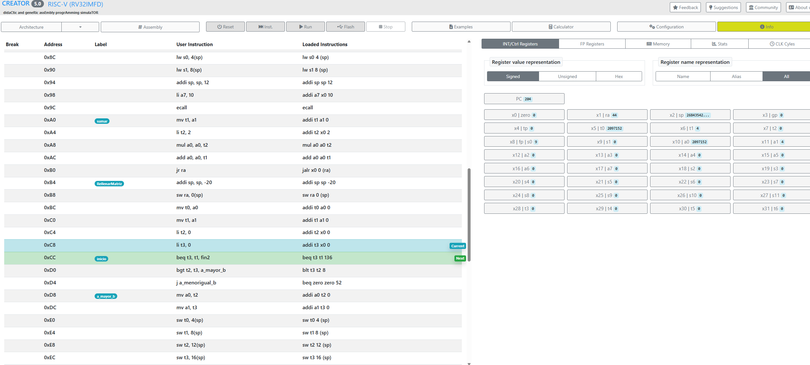

# 🧮 Integral numérica y matriz de integrales en ensamblador RISC-V

**Práctica 1 · Introducción al lenguaje ensamblador** · Ingeniería Informática · UC3M · Grupo 85

Implementación en ensamblador **RISC-V** del cálculo aproximado de una integral definida mediante una suma de Riemann en coma flotante, y de su uso para rellenar una matriz de 5×5 con integrales entre distintos límites.



## 📚 Índice

- [Qué hace](#-qué-hace)
- [Ejercicio 1: `compute_integral`](#-ejercicio-1-compute_integral)
- [Ejercicio 2: `integral_matrix`](#-ejercicio-2-integral_matrix)
- [Estructura del proyecto](#-estructura-del-proyecto)
- [Ejecución](#-ejecución)
- [Batería de pruebas](#-batería-de-pruebas)
- [Aprendizajes y detalles de implementación](#-aprendizajes-y-detalles-de-implementación)
- [Autores](#-autores)

## 🎯 Qué hace

Dada la función cuadrática

```
f(x) = p·x² + q·x + r
```

el programa aproxima su integral entre `a` y `b` como

```
∫ f(x) dx ≈ h · Σ f(a + n·h)      con h = (b − a) / N
```

y usa ese cálculo para construir una matriz de integrales. Todos los cálculos se hacen en **coma flotante** (resultado en `fa0`).

## 1️⃣ Ejercicio 1: `compute_integral`

Calcula el sumatorio de `f` para `n = 0 … N-1` (con `N = 1000`) y lo multiplica por `h`.

| Función | Descripción |
|---|---|
| `compute_integral` | Calcula `h = (b − a) / N`, recorre el bucle con `x = a + n·h`, llama a `funcionf` en cada iteración, acumula el resultado y lo multiplica por `h` al final |
| `funcionf` | Evalúa `f(x) = p·x² + q·x + r`. Calcula `q·x + r` directamente y obtiene `x²` llamando a `pow` |
| `pow(x, n)` | Eleva `x` (coma flotante, en `fa0`) a un exponente entero (en `a0`); aquí se usa con exponente 2 |

**Pseudocódigo**

```
compute_integral:
    n = 0 ; N = 1000 ; h = (b - a) / N
    while n != N:
        x = a + n·h
        (guardar en pila)
        resultado += funcionf(p, q, r, x)
        (recuperar de pila)
        n = n + 1
    resultado = resultado · h

funcionf:
    result  = q·x + r        (guardar en pila)
    result2 = pow(x, 2)
    result  = result + result2 · p   (recuperar de pila)
    return result
```

Al terminar el bucle, la etiqueta `fin` decide qué hacer: si se ejecuta de forma independiente, finaliza el programa (`a7 = 10`, `ecall`); si ha sido llamada desde el ejercicio 2, salta a `retorno` para devolver el control.

## 2️⃣ Ejercicio 2: `integral_matrix`

Rellena una matriz de **M × M** (M = 5) con el valor de la integral (con **N = 100**) para cada par de índices `(a, b)`:

- Si `b > a` → se guarda `compute_integral(a, b, p, q, r)`.
- Si `b ≤ a` → se guarda `0`.

Como la memoria del procesador es lineal, la posición de cada elemento se calcula como `b·M + a`, y como cada dato ocupa 4 bytes hay que alinear con `slli t0, t0, 2` antes de hacer `sw` (sin ese desplazamiento da error).

**Pseudocódigo**

```
a = 0 ; b = 0 ; M = 5
while b < M:
    if b <= a:
        matriz[a, b] = 0
        a = a + 1
    elif b > a:
        (guardar en pila)
        matriz[a, b] = compute_integral(a, b, p, q, r)
        (recuperar de pila)
        a = a + 1
    if a >= M:
        a = 0
        b = b + 1
fin
```

| Etiqueta | Función |
|---|---|
| `bucle1` | Avanza por la matriz y decide si guardar un cero o calcular la integral |
| `escero` | Calcula la posición del elemento y almacena `0` |
| `integral` | Apila los datos, llama a `compute_integral`, recupera los datos y almacena el resultado |
| `fin1` | Pone `a = 0` y avanza a la siguiente `b` |
| `fin2` | Termina el programa (`a7 = 10`, `ecall`) |

## 🗂 Estructura del proyecto

<!-- TODO: ajusta los nombres a los de tu repo -->
```
.
├── compute_integral.s     # Ejercicio 1: compute_integral, funcionf, pow
├── integral_matrix.s      # Ejercicio 2: integral_matrix
├── memoria.pdf            # Memoria de la práctica
├── Risc-V.png
└── README.md
```

## 🚀 Ejecución

<!-- TODO: indica el simulador/ensamblador que usáis (RARS, Ripes, Venus...) y cómo cargar los ficheros -->

1. Abre el fichero `.s` en el simulador RISC-V.
2. Ajusta los datos de la sección `.data` (`a`, `b`, `p`, `q`, `r`).
3. Ensambla y ejecuta.
4. Ejercicio 1: el resultado queda en el registro `fa0`. Ejercicio 2: la matriz queda almacenada en memoria.

## 🧪 Batería de pruebas

### Ejercicio 1

Con `p = 2`, `q = 5`, `r = 10`, la integral exacta entre 0 y 3 es **70,5**.

| Prueba | Datos | Esperado | Obtenido |
|---|---|---|---|
| Un solo paso | `a=0, b=3, N=1` | Suma de un término = 30 | `fa0 = 30` |
| Más pasos | `N=100` | Valor cercano a 70,5 | `70,00588` |
| Máxima precisión | `N=1000` | Aún más cercano a 70,5 | `70,45045` |
| `N = 0` | Datos cualesquiera | Error o resultado 0 | `Division by zero not allowed` |
| `jal ra` en lugar de `jr ra` | Datos cualesquiera | Fallo de lectura | No identifica `integral_matrix` |
| `a > b` | `a=65, b=3` | Resultado negativo | Devuelve valor negativo |
| Valor desorbitado | `b ≈ 3,4·10³⁸...` | Máximo representable en IEEE 754 simple: ≈ 3,4028235·10³⁸ | El ensamblador devuelve error de sintaxis o rango, probablemente por el tamaño del valor |

La aproximación mejora al aumentar `N`, como cabía esperar de una suma de Riemann.

### Ejercicio 2

| Prueba | Esperado | Obtenido |
|---|---|---|
| `N = -1` | Error o sin almacenaje | Cuando `b > a`, `fa0` vale 0 y la matriz queda vacía |
| `M = 2` | Un único dato distinto de cero | Solo una posición de la matriz tiene valor distinto de 0 |
| `a > b` siempre (con `a < M`) | Matriz llena de ceros | Se almacenan ceros en toda la matriz |
| `a < b` siempre (con `a, b < M`) | Matriz llena de valores no nulos | Matriz rellena con datos distintos de 0 |

## 💡 Aprendizajes y detalles de implementación

- **Guardar en la pila antes de llamar a otra función.** Cada función que invoca a otra debe apilar sus datos y `ra`; si no, los registros se corrompen y el programa se descontrola.
- **Conversión a coma flotante.** Como `h` no es entero, hay que convertir los enteros con `fcvt.s.w` antes de operar con ellos.
- **Matriz como lista.** La memoria no entiende de matrices: la posición se calcula con una fórmula fila·ancho + columna, y se alinea a 4 bytes.
- **Control del flujo entre ejercicios.** La etiqueta `fin` de `compute_integral` comprueba una condición para volver a `integral_matrix` (`retorno`) o terminar el programa.

## 👥 Autores

- [Jaime Sánchez Sánchez](https://github.com/jaimesanchez-dev)
- Ana Díaz Jiménez

Práctica 1 · Introducción al lenguaje ensamblador · Ingeniería Informática, UC3M.

Readme hecho con Claude
